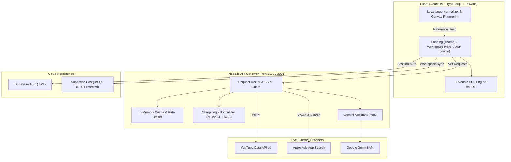

# WOLVGUARD — Digital Risk Protection
**Team WOLVANT · “See the Impersonation. Stop the Threat.”**

[](https://github.com/vinni8871/wolvguard)
[](https://github.com/vinni8871/wolvguard)
[](https://github.com/vinni8871/wolvguard)
[](https://github.com/vinni8871/wolvguard)

---

## ⚡ Quick Start

```sh
# 1. Install dependencies
npm install

# 2. Build frontend
npm run build

# 3. Start unified production server
npm start
```
* **Application**: `http://localhost:5173` (Frontend + API Gateway)
* **Dev Mode**: `npm run dev:api` (Port 3001) + `npm run dev` (Port 5173 with API proxy)

---

## 🚀 How Far We’ve Come (Progress Tracker)

| Stage | Feature Area | Status | Delivered Capabilities |
|---|---|:---:|---|
| **Round 1 (MVP)** | **App Store Monitoring** | ✅ Completed | Real Apple Ads search, Adam ID extraction, listing URLs, real publisher metadata. |
| **Round 1 (MVP)** | **Social Surveillance** | ✅ Completed | Real YouTube Data API channel search, channel avatars, subscriber/handle inspection. |
| **Round 1 (MVP)** | **Detection Engine** | ✅ Completed | Transparent 4-signal heuristic: Levenshtein distance, token cosine similarity, publisher variance, and 64-bit dHash + RGB logo matching. |
| **Round 1 (MVP)** | **Brand Profile & Exclusions** | ✅ Completed | Official asset registration, evidence attestation, instant exclusion of verified IDs to avoid self-flagging. |
| **Round 2** | **Cloud Persistence & Auth** | ✅ Completed | Supabase integration with RLS, secure Email/Password auth, multi-table workspace sync (`brands`, `brand_assets`, `scan_runs`, `candidates`, `findings`, `reviews`, `notifications`). |
| **Round 2** | **AI Threat Assistant** | ✅ Completed | Server-side Gemini API integration (`/api/chat`) with prompt sanitization, rate limits, and contextual risk explanations. |
| **Round 2** | **Forensic PDF Export** | ✅ Completed | One-click courtroom/takedown-ready PDF reports (`lib/scan-report.ts` via `jsPDF`) for full scan audits and single-candidate evidence dossiers. |
| **Round 2** | **Unified Architecture** | ✅ Completed | Single-port production server (`server/index.mjs`), in-memory caching (5 min), SSRF image guardrails, responsive navigation, password visibility toggles. |
| **Round 2** | **Test Coverage & Audits** | ✅ Completed | 22 unit tests (`tsx --test`) + 17 server tests (`node --test`), 100% pass rate. |

---

## 🏗️ Architecture & Data Flow



---

## 📂 Project Structure

```
c:\TEAM-WOLVANTT
├── components/
│   ├── live/
│   │   ├── LiveWorkspace.tsx        # Main live monitoring dashboard & review station
│   │   ├── types.ts                 # Core TypeScript models (Brand, Candidate, Scan, Alerts)
│   │   └── ...                      # Drawer views, scan controls, and stat cards
│   └── ui/                          # Reusable UI primitives (Buttons, Dialogs, Logos)
├── lib/
│   ├── detection.ts                 # Foundational similarity math (Levenshtein, Cosine)
│   ├── live-detection.ts            # Dynamic 4-signal heuristic scorer & thresholds
│   ├── scan-report.ts               # Forensic PDF report generator (jsPDF engine)
│   ├── scan-report.test.ts          # PDF generation & metric unit tests
│   ├── image-signature.ts           # Browser-side canvas image hashing
│   └── supabase.ts                  # Supabase client, auth handlers, and two-way sync
├── server/
│   ├── index.mjs                    # Production HTTP server + static build host + API router
│   ├── dev.mjs                      # Local dev API runner (Port 3001)
│   ├── providers.mjs                # Adapters for YouTube, Apple Ads, and Bluesky APIs
│   ├── providers.test.mjs           # Validation, rate-limiting, and error-handling tests
│   ├── assistant.mjs                # Gemini conversational API proxy & prompt builder
│   ├── assistant.test.mjs           # Assistant rate limit and sanitization tests
│   └── images.mjs                   # Secure SSRF-guarded image fetching & Sharp dHash64
├── supabase/
│   ├── schema.sql                   # Complete PostgreSQL schema with RLS security policies
│   ├── migrations/                  # Incremental DB migration scripts
│   └── DEPLOYMENT.md                # Cloud setup and RLS deployment manual
├── tests/
│   ├── full-audit.mjs               # End-to-end browser audit workflow
│   ├── demo-controls.mjs            # Synthetic UI regression tests
│   └── landing-marquee.mjs          # Landing page animation tests
├── public/                          # Static assets and judge presentation deck
├── App.tsx                          # Root router, auth states, and navigation shell
├── main.tsx                         # React 19 application entry point
├── styles.css                       # Responsive stylesheets, layout tokens, dark theme
├── vite.config.ts                   # Vite configuration with API reverse-proxy
└── package.json                     # Scripts and project dependencies
```

---

## 🧭 Next Steps: What We’re Doing Next (Future Roadmap)

Next manam inka execute cheyaboye high-impact features:

1. **Google Play Store Deep Monitoring**
   * Expand from Apple App Store to Google Play indexes.
   * Scrape/query package IDs, developer contacts, download tier metrics, and permissions.
2. **Autonomous Typosquatting & Homoglyph Generator**
   * Proactive permutation engine searching lookalike Unicode characters (e.g., Cyrillic `а` vs Latin `a`), visually identical character swaps (`rn` vs `m`), and high-risk phishing suffixes (`-login`, `-verify`, `-support`).
3. **1-Click Takedown Automation & Abuse Desk Webhooks**
   * Auto-generate pre-filled, platform-compliant DMCA notices for Apple Legal, Google Play Copyright Desk, and YouTube Impersonation portals.
4. **Scheduled Background Cron Surveillance**
   * Continuous unattended polling workers with instant push notifications (Slack / Discord / Email webhooks) when high-severity candidates are detected.
5. **Team Workspaces & Role-Based Access Control (RBAC)**
   * Multi-user organization management in Supabase: Analyst, Investigator, and Admin roles.

---

## 🎯 Short & Crispy Summary

> **Current State:** 
> Built a solid, demonstrable digital risk protection platform. Real YouTube channel surveillance, real Apple Ads queries, automated 4-signal heuristic scoring, pixel-accurate logo comparison, Supabase cloud sync, Gemini AI guidance, and courtroom-ready PDF evidence exports. All 39 tests passing with zero errors.
>
> **Up Next:** 
> Expanding to Google Play Store, automated typosquatting permutations, background recurring scan workers, and 1-click legal takedown webhooks! 🚀
